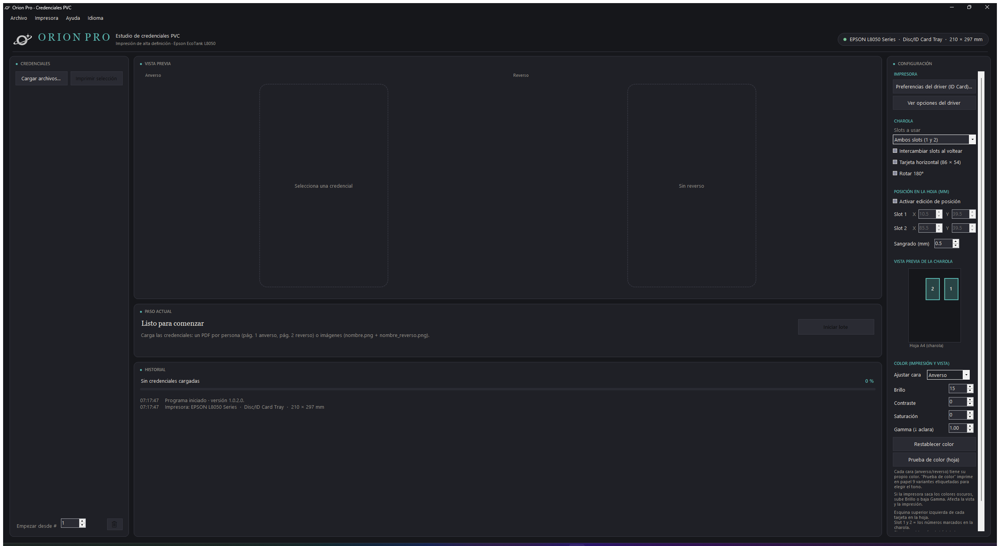

# ✦ Orion Pro

### Estudio de impresión de credenciales PVC

**Impresión por lotes de tarjetas PVC (CR80) en impresoras Epson EcoTank L8050 — charola *Disc / ID Card*.**

[**⬇ Descargar la última versión**](https://github.com/nomikugg/orion/releases/latest)

---

## 📸 Vista general

> Interfaz oscura de una sola pantalla: lista de credenciales, vista previa de **anverso y reverso**, configuración de charola y ajuste de color por cara.

---

## ✨ ¿Qué hace?

Orion Pro imprime **credenciales plásticas (PVC, tamaño tarjeta de crédito CR80 · 85,6 × 54 mm)** de forma masiva y precisa, usando la bandeja de tarjetas de la **Epson EcoTank L8050**. Está pensado para quien produce carnets, membresías, gafetes o identificaciones y necesita que **todas salgan igual, bien alineadas y con el color correcto**.

- 🗂️ **Impresión por lotes** — carga muchas personas de una vez y la app imprime una tras otra sin que tengas que reconfigurar nada.
- 🔄 **Anverso y reverso** — flujo guiado: imprime todos los frentes, te avisa para voltear las tarjetas y luego imprime los reversos. También puedes imprimir **solo el reverso** o una sola cara.
- 🎯 **Dos tarjetas por hoja (Slot 1 y Slot 2)** — aprovecha ambas posiciones de la charola; se configuran de forma independiente.
- 📐 **Posición ajustable al milímetro** — mueve cada slot en X/Y para que la impresión caiga exacta sobre el plástico. Con **candado "Activar edición de posición"** para no descalibrar por accidente.
- 🎨 **Color WYSIWYG** — lo que ves en la vista previa es **lo que se imprime**. Brillo, contraste, saturación y gamma, **con un perfil distinto para el anverso y otro para el reverso**.
- 🧪 **Prueba de color en papel** — imprime una hoja normal con **9 variantes etiquetadas** del mismo diseño para elegir el tono exacto sin gastar tarjetas.
- 🩸 **Sangrado (bleed)** configurable — evita los bordes blancos por microdesalineación del plástico.
- 🖨️ **Guía de calibración** — imprime una plantilla para encontrar la posición perfecta de tu charola.
- 🌎 **Español / Inglés** — se elige en la instalación o desde el menú **Idioma**.
- ♻️ **Actualizaciones automáticas** — la app avisa cuando hay una versión nueva.

---

## 🧭 Interfaz de un vistazo

| Zona | Para qué sirve |
|------|----------------|
| **Credenciales** (izquierda) | Cargar archivos, elegir desde qué número empezar y quitar de la lista. |
| **Vista previa** (centro) | Ver cómo quedará el **anverso** y el **reverso** con el color ya aplicado. |
| **Paso actual** | El asistente te dice qué hacer en cada momento (cargar, imprimir, voltear…). |
| **Historial** | Registro de todo lo que ocurre: impresora detectada, avances, errores. |
| **Configuración** (derecha) | Impresora, charola, slots, posición, vista de la charola y color. |

---

## 💾 Requisitos

- **Windows 10 u 11** (64 bits).
- Impresora **Epson EcoTank L8050** con la **bandeja de tarjetas / Disc (ID Card)** instalada y su driver oficial de Epson.
- Tarjetas **PVC CR80** (85,6 × 54 mm) compatibles con inyección de tinta.

---

## ⬇️ Instalación

1. Entra a **[Releases](https://github.com/nomikugg/orion/releases/latest)** y descarga el instalador `Orion-Setup-x.x.x.x.exe`.
2. Ejecútalo y sigue los pasos (elige idioma). Se instala para el usuario actual, sin necesidad de administrador.
3. Abre **Orion Pro** desde el menú Inicio.

> Windows SmartScreen puede mostrar un aviso la primera vez (instalador nuevo, aún sin reputación): **Más información → Ejecutar de todas formas**.

---

## 🚀 Cómo imprimir (resumen)

1. **Prepara los archivos.** Un **PDF por persona** (página 1 = anverso, página 2 = reverso) **o** imágenes (`nombre.png` + `nombre_reverso.png`).
2. **Cargar archivos…** y selecciona a las personas.
3. Comprueba la **charola** (Slot 1 a la derecha, Slot 2 a la izquierda) y la **posición** en la vista previa.
4. Ajusta el **color** si hace falta (usa *Prueba de color (hoja)* en papel normal antes de gastar plástico).
5. **Iniciar lote.** Imprime los anversos → voltea las tarjetas cuando te avise → imprime los reversos.

💡 **Bordes blancos:** sube el **Sangrado** a 1,5–2 mm.
💡 **Color muy oscuro:** sube **Brillo** o baja **Gamma** (el perfil del anverso y del reverso son independientes).

---

## 🔑 Licencia y soporte

Orion Pro incluye una **versión de prueba**. Para uso continuo se adquiere una **licencia** vinculada a tu equipo:

1. Abre **Ayuda → Licencia** y copia tu **ID de equipo**.
2. Envíalo por **WhatsApp** (botón dentro de la app) para recibir tu clave.
3. Pégala en **Licencia → Activar**. ¡Listo!

Para dudas, soporte o adquirir una licencia, escríbenos por **WhatsApp** desde el menú **Ayuda → Comprar licencia (WhatsApp)**.

---

**Orion Pro** · Impresión de alta definición · Epson EcoTank L8050

© 2026 Fernando Arroyo. Todos los derechos reservados.

